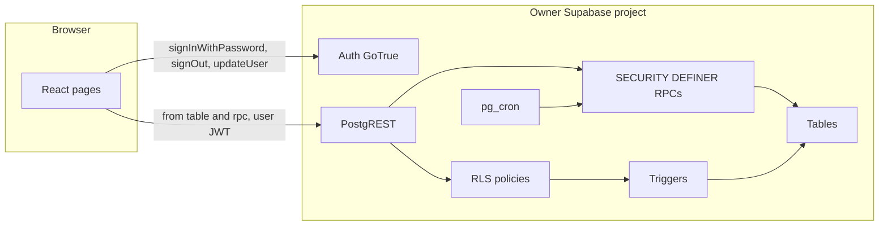

# API structure

**အကျဉ်း (မြန်မာ)** — ဤစာရွက်သည် `main` (`9ddc8c0`, migration `0001`–`0029`) ပေါ်က API ကို repo ထဲက SQL နှင့် React client မှ ကောက်ထားခြင်းဖြစ်သည်။ အက်ပ်သည် custom server မရှိပါ။ Supabase JS (publishable key) ဖြင့် ဇယားဖတ်/ရေး၊ `rpc()`၊ နှင့် username + PIN login (`<username>@waterfactory.local`) ကို ခေါ်သည်။ စည်းမျဉ်းကို RLS နှင့် trigger က ဒေတာဘေ့စ်တွင် စစ်သည်။ Edge Function `admin-create-user` ကို UI က မခေါ်ပါ။ PR [#4](https://github.com/Khinelintun91/water-factory-management-system/pull/4) (migration `0030`) နှင့် PR [#5](https://github.com/Khinelintun91/water-factory-management-system/pull/5) (migration `0031`) ကို မပေါင်းရသေးသဖြင့် ဤစာရွက်တွင် မပါပါ။ ကွာဟချက်များကို အဆုံးတွင် ဖော်ပြထားသည်။

This document describes how the browser talks to Supabase on **main as of `9ddc8c0`** (migrations `0001` through `0029` only). It was read from `supabase/migrations/`, `src/`, and `supabase/functions/`. It is not a live-database dump. No keys, project URLs, or passwords are recorded here.

Open pull requests that are **not** on main:

- [PR #4](https://github.com/Khinelintun91/water-factory-management-system/pull/4) adds migration `0030` (`admin_create_user` / `admin_reset_pin` accept primary role `co_owner`, with the manager PIN length).
- [PR #5](https://github.com/Khinelintun91/water-factory-management-system/pull/5) adds migration `0031` (a trigger so `agents.closed_at` and `agents.closed_by` can change only inside `finalize_closeout`).

What those PRs would change is in [Unmerged pull requests](#unmerged-pull-requests). The rest of this file is main.

## Data flow

There is no application server. The React app (Vite, static host) uses `@supabase/supabase-js` with `VITE_SUPABASE_URL` and `VITE_SUPABASE_PUBLISHABLE_KEY` (`src/lib/supabase.ts`). The publishable key is the anon key. The service-role key is not in the client. Postgres row-level security (RLS) and triggers are the access boundary. `SECURITY DEFINER` functions bypass RLS and must check the caller themselves.

Not on this path: Realtime (`src` never calls `.channel()`), Storage, and the Edge Function under `supabase/functions/admin-create-user/` (the file says it is not the live path; `src/` never calls `functions.invoke`). The notification bell polls `notifications` every 30 seconds (`src/components/NotificationBell.tsx`).

`pg_cron` (migration `0012`) schedules two jobs in UTC:

| Job | Cron | Function |
|---|---|---|
| `wfms-daily-digest` | `30 12 * * *` (19:00 Asia/Yangon) | `send_daily_digest()` |
| `wfms-data-quality` | `0 2 * * *` (08:30 Asia/Yangon) | `run_data_quality_alerts()` |

Both functions are `SECURITY DEFINER`. Migration `0026` revokes `EXECUTE` from `public`, `anon`, and `authenticated`. They are not a client API.

## Roles

`user_role` is `owner`, `manager`, `staff`, `agent` (`0001`), plus `co_owner` (`0006`). One account has one primary role on `profiles.role` and any extra grants in `user_roles`.

| Helper | What it returns | Who it treats as allowed |
|---|---|---|
| `app_role()` | Primary `profiles.role` for `auth.uid()` | One value. No extra roles. `co_owner` stays `co_owner`. |
| `app_agent_id()` | `profiles.agent_id` | Set for a primary agent account. |
| `has_role(role)` | boolean | Primary role **or** a `user_roles` row, and only if `profiles.active`. `co_owner` counts as `manager`. |
| `is_owner_manager()` | boolean | `has_role('owner')` or `has_role('manager')`. |
| `is_staff_plus()` | boolean | owner, manager (including co-owner), or staff, via `has_role`. |

`has_role` requires `profiles.active`. A deactivated account fails these helpers even if a JWT is still present. The login screen also signs the user out when `profiles.active` is false (`src/context/AuthContext.tsx`).

**Co-owner follows the Manager column** in the matrices below, because `has_role('manager')` is true. Cells marked **primary owner** use `app_role() = 'owner'` or `profiles.role = 'owner'`. A co-owner does not pass those. An extra `user_roles` grant of `owner` makes `has_role('owner')` true, but it does **not** change `app_role()`.

Route guards in `src/App.tsx` use effective roles (`roles.includes`, and co-owner adds `manager` in the client). RLS is the real boundary. Where the page and the policy disagree, that is listed under [Gaps](#gaps--follow-ups).

## How errors reach the UI

PostgREST puts the Postgres exception text in `error.message`. A failed `SELECT` under RLS usually returns **no rows**, not an error. A failed `INSERT` / `UPDATE` / `DELETE` returns an error (`new row violates row-level security policy`, or the trigger's `raise exception` text).

Most pages assign `error.message` straight into a Burmese screen (`setMsg`, `onError`, `setCardError`). Mapped cases:

| Source | Code or condition | What the UI shows |
|---|---|---|
| Login | `login_lock_status` / `log_failed_login` returns a timestamp | Burmese lock message with the unlock time (`fmtTime12`) |
| Login | `signInWithPassword` fails and the account is not locked | `အမည် သို့မဟုတ် PIN မှားနေပါတယ်` |
| Login | profile missing or `active` false | `ဒီအကောင့် ပိတ်ထားပါတယ် — ပိုင်ရှင်ကို ဆက်သွယ်ပါ` (then sign-out) |
| Login | `log_login_attempt` throws | Swallowed. Login is not blocked. |
| Login | `clear_login_failures` throws | Swallowed. |
| `UsersPage.rpcCodeMessage` | `username_taken`, `invalid_username`, `pin_must_be_4_to_12_digits`, `pin_must_be_6_to_12_digits`, `agent_id_required` | Burmese sentence |
| `UsersPage` | any other `admin_create_user` / `admin_reset_pin` error (`owner_only`, `invalid_role`, `agent_not_found`, `user_not_found`, `last_owner`) | Burmese prefix plus the raw `error.message` |
| `PayrollPage.readablePayError` | `already_paid:`, `month_locked:`, `forbidden` | Burmese sentence |
| `EntriesPage` offline queue | message contains `same_day_only` | Queued insert is dropped and counted as stale |
| `EntriesPage` offline queue | any other insert error | Flush stops; the raw message is shown |
| `MyPage` dispute insert | any error | `တင်ပြ၍ မရပါ: ` plus `error.message` |
| Home PIN change | UI rejects non-digit or length outside 6–12 before the call | Burmese validation text |
| Home PIN change | `signInWithPassword` fails | `လက်ရှိ PIN မှားနေပါတယ်` |
| Home PIN change | `updateUser` fails | GoTrue `error.message`, or `PIN ပြောင်း၍ မရပါ` |
| Missing env | no URL or publishable key | Login is replaced by `စနစ် မပြင်ဆင်ရသေးပါ` |
| Signed in, no profile row | `profiles` select returns nothing | `အကောင့် မှတ်တမ်း မတွေ့ပါ` and a sign-out button |

`HistoryPage` loads `audit_log` and does not read `error`. A denied or failed query looks like an empty history.

Trigger and RPC exception strings (the part the UI usually shows raw):

| Exception prefix | Raised by |
|---|---|
| `same_day_only` | `guard_same_day_edit`, `guard_insert_today` |
| `month_locked` | `guard_month_lock`, `guard_month_lock_text`, `pay_month` |
| `agent_not_found` | `entries_before_write`, `finalize_closeout`, `admin_create_user` |
| `agent_closed` | `entries_before_write` when `agents.closed_at` is set |
| `bottle_limit` | `entries_before_write` |
| `deposit_limit` | `entries_before_write` |
| `credit_limit` | `entries_before_write`, and only when `app_role() = 'staff'` |
| `forbidden` | `finalize_closeout`, `pay_month`, `collections_summary`, `agent_held_totals`, `agent_outstanding`, `hard_delete_agent` (`forbidden: owner only` / `forbidden: owner/manager only`) |
| `already_closed` | `finalize_closeout` |
| `bad_returned`, `receivable_open`, `bad_price` | `finalize_closeout` |
| `not_settled` | `hard_delete_agent` |
| `already_paid` | `pay_month` |
| `owner_only`, `invalid_username`, `invalid_role`, `pin_must_be_N_to_12_digits`, `agent_id_required`, `username_taken`, `user_not_found` | `admin_create_user` / `admin_reset_pin` |
| `last_owner` | `guard_last_owner` (`errcode` `P0001`) |
| `owner_manager_only`, `invalid_months` | `report_range`, `report_months`, `report_aging` |
| `data_quality_scan: owner/manager only` | `data_quality_scan` (`42501`) |
| `agent_detail_stats: not allowed`, `inventory_totals: not allowed` | those RPCs (`42501`) |

## Auth

Login is username + PIN. The client maps the username to `<username>@waterfactory.local` and calls GoTrue `signInWithPassword` with the PIN as the password (`src/lib/supabase.ts`, `src/context/AuthContext.tsx`).

Order on the login page:

1. `rpc('login_lock_status', { p_username })` as **anon**. Returns `timestamptz` or null. A timestamp means the account is locked.
2. `auth.signInWithPassword({ email, password: pin })`.
3. On failure, `rpc('log_failed_login', { p_username, p_user_agent })`. That function writes one `login_logs` failure row and, via `record_login_failure`, counts toward a lock: 5 failures, then `locked_until = now() + 15 minutes` (`0006`). A bad username shape (not `^[a-z0-9_.-]{1,64}$`) returns null and does not count.
4. On success, load `profiles` and `user_roles`. If the profile is missing or `active` is false, sign out.
5. `rpc('clear_login_failures')` deletes the caller's `pin_attempts` row (looked up from `profiles.username`).
6. `rpc('log_login_attempt', { p_username, p_success, p_user_agent })` on the locked-before-attempt path and on success. `log_failed_login` already writes the failure log, so the failure branch does not call `log_login_attempt` again.

`log_login_attempt` drops junk usernames and stops inserting when that username has 20 rows in the last minute, or the whole table has 300 rows in the last minute (`0026`).

Self-service PIN change (`HomePage` `PinChangeCard`) re-checks the current PIN with `signInWithPassword`, then `auth.updateUser({ password })`. The form requires 6–12 digits for every role. There is no database function on that Auth call. Owner reset of someone else's PIN is `admin_reset_pin` (below), which also clears `pin_attempts`.

Account creation does **not** go through the Edge Function. `UsersPage` calls `admin_create_user` and `admin_reset_pin`.

### Edge Function `admin-create-user` (not called)

`supabase/functions/admin-create-user/index.ts` is a Deno reference. Its header says it could not be deployed from the build environment and must not be wired back without deploying it. The live path is migration `0014`.

If it were invoked: `POST` JSON `{ username, pin, role, agent_id?, display_name? }`. It checks the caller JWT, loads `profiles` with the service role, and requires `role = 'owner'` and `active`. It accepts primary roles `owner`, `manager`, `staff`, `agent` only. PIN length matches `0014` (owner/manager 6–12 digits, staff/agent 4–12). Errors are JSON `{ error }` with HTTP 400/401/403/405 (`method_not_allowed`, `unauthorized`, `owner_only`, `invalid_username`, `invalid_role`, `pin_must_be_N_to_12_digits`, `agent_id_required`). Success is `{ profile }`.

## Table permission matrix

RLS is enabled on every public table below. Policies are `TO authenticated` unless noted. **anon** has no table policy except the one `0026` dropped (`login_logs` insert). With RLS on and no matching policy, the client sees no rows and cannot write.

Legend: **S** select, **I** insert, **U** update, **D** delete, **own** = the caller's row or linked agent, **—** = denied, **OM** = `is_owner_manager()` (owner, manager, co-owner, including extra grants, active profile), **S+** = `is_staff_plus()`, **P-owner** = primary `app_role() = 'owner'`.

Co-owner is shown only where it differs from Manager. Otherwise Co-owner = Manager.

| Table | anon | Owner | Manager | Co-owner | Staff | Agent |
|---|---|---|---|---|---|---|
| `profiles` | — | S all, I, U | S all | S all | S own | S own |
| `agents` | — | S all, I, U | S all, I, U | same | S all | S own (`id = app_agent_id()`) |
| `agent_contacts` | — | S all, I, U | S all, I, U | same | — | S own, U own |
| `daily_entries` | — | S all, I, U, D | same | same | same | S own |
| `agent_payments` | — | S all, I, U, D | same | same | same | S own |
| `expenses` | — | S, I, U, D | same | same | — | — |
| `expense_categories` | — | S, I, U | same | same | S | — |
| `inventory_movements` | — | S all, I, U, D | same | same | same | S own (`agent_id`) |
| `disputes` | — | S all, I, U | same | same | — | S own, I own |
| `month_locks` | — | S, I, D | S, I | S, I | S | S |
| `audit_log` | — | S | S | S | — | — |
| `login_logs` | — | S | — | — | — | — |
| `app_settings` | — | S, I, U | S | S | S | S |
| `push_tokens` | — | S all, I/U/D own | S all, I/U/D own | same | I/U/D own, S own | same as staff |
| `user_roles` | — | S all, I, D | S all | S all | S own | S own |
| `pin_attempts` | — | — | — | — | — | — |
| `agent_deposits` | — | S all, I, U, D | same | same | — | S own |
| `write_offs` | — | S all, I, U, D | same | same | — | S own |
| `agent_settlements` | — | S, I | same | same | — | — |
| `salary_settings` | — | S, I, U | same | same | — | — |
| `advances` | — | S, I, U, D | same | same | — | — |
| `bonuses` | — | S, I, U, D | same | same | — | — |
| `payroll_runs` | — | S | S | S | — | — |
| `advance_repayments` | — | S | S | S | — | — |
| `cash_handovers` | — | S, I, U, D | same | same | — | — |
| `notifications` | — | S/U/D own | same | same | same | same |
| `notify_prefs` | — | S/I/U own | same | same | same | same |
| `dq_seen` | — | — | — | — | — | — |

No client **DELETE** policy: `profiles`, `agents`, `agent_contacts`, `expense_categories`, `disputes`, `audit_log`, `login_logs`, `app_settings`, `salary_settings`, `payroll_runs`, `advance_repayments`, `pin_attempts`, `dq_seen`, `notify_prefs` (no delete). `month_locks` has delete for primary owner only (that is the unlock). `agent_settlements` has no update or delete policy.

`auth.users` and `auth.identities` are not in the client table list. `admin_create_user` inserts them. `admin_reset_pin` and `auth.updateUser` change the password hash. The in-app backup does not export them (`src/lib/backup.ts`).

### Per-table rules

Triggers named below are the ones still defined after `0029`. "Audit" means `AFTER INSERT OR UPDATE OR DELETE` → `audit_row_change()` (`SECURITY DEFINER`, `search_path = public`), which writes `old_data` / `new_data` and `actor = auth.uid()`. There is no update or delete policy on `audit_log` and no purge function.

**`profiles`** — one row per Auth user: `id`, `username`, `display_name` (`0013`), `role`, `agent_id`, `active`, `created_at`. Purpose: identity for RLS. Client: login and `UsersPage` (list, set `active`, display name), `HomePage` / `PayrollPage` / `HandoverPage` name lookups. Insert of a normal account is `admin_create_user`, which runs as definer and bypasses the insert policy. Direct insert/update still requires primary owner. Delete is not offered; `ON DELETE CASCADE` from `auth.users` would delete the profile if the auth user were removed. Trigger `profiles_last_owner` (`0026`): the last **active** primary owner cannot be deactivated, re-roled, or deleted (`last_owner`). Trigger `profiles_audit`. No same-day or month-lock trigger.

**`agents`** — delivery agents. Columns from `0001` / `0006` / `0016`: `id`, `code`, `name`, `address`, `deposit_per_bottle`, `default_unit_price`, `bottle_limit`, `credit_limit`, `closed_at`, `closed_by`, `trip_qty`, `notes`, `active`, `created_at`, `updated_at`. Phone is **not** a column. Client: `AgentsPage` insert and update (`active`, price, deposit, limits, `trip_qty`), detail/close-out reads. `updated_at` via `set_updated_at`. Audit via `agents_audit`. No same-day guard and no month lock (`0027` says so). `finalize_closeout` sets `closed_at`, `closed_by`, and `active = false`. On main, an owner/manager `UPDATE` can also write those columns. See [Gaps](#gaps--follow-ups) and PR #5.

**`agent_contacts`** — `agent_id`, `phone`, timestamps. SPEC rule 2. Owner/manager read and write every row. An agent reads and updates their own row. Staff have no policy. `AgentsPage` reads phones and inserts a row when creating an agent. Audit + `updated_at`. No same-day or month lock.

**`daily_entries`** — deliveries. Staff, owner, and manager (effective) read all and write. An agent reads rows with `agent_id = app_agent_id()` and cannot insert. Client: `EntriesPage` (insert, update, delete, offline queue), `MyPage`, `CollectionsPage` (ledger on expand), `HomePage` day totals, reports and data-quality fetches. Columns include `entry_date`, quantities, `unit_price`, `amount`, `amount_collected`, `agent_name`, `change_reason`, `notes`, `created_by`. `agent_id` is nullable after `0006` so a hard delete can detach the row.

Triggers, in order: `entries_attribution` (forces `created_at = now()`, `created_by = auth.uid()`), `entries_fill_name`, `entries_before_write`, `entries_insert_today` (`entry_date`), `entries_same_day`, `entries_month_lock` (`entry_date`), `entries_updated`, `entries_audit`. `entries_before_write` rejects a missing agent, a closed agent, bottle limit, deposit-bottle coverage, and (primary staff only) credit limit. It overwrites `unit_price` from the agent on insert and sets `amount = delivered_qty * unit_price`.

**`agent_payments`** — collections. Same RLS shape as entries. Extra columns: `agent_name`, `change_reason`, `kind` (`regular` or `old_debt`, `0016`). Client: `PaymentsPage`, `EntriesPage` (cash on delivery), `CloseoutPage`, `CollectionsPage`. Triggers: attribution, fill name, insert-today (`payment_date`), same-day, month lock, `updated_at`, audit. No `closed_at` check: a payment for a closed agent is still allowed by RLS and triggers.

**`expenses`** / **`expense_categories`** — owner/manager money. Staff may read category names (entry forms) and may not read expenses. Client: `ExpensesPage`, `exports.ts` (category names), `HomePage` day expense sum (staff and agents get an empty set from RLS, not an error). Expense triggers: attribution, insert-today, same-day, month lock, `updated_at`, audit. Categories: audit only. No category delete policy.

**`inventory_movements`** — stock. `kind` is `produce`, `purchase`, `damage`, `in`, `out`, or `adjust` (`0006`, `0016`). RLS is staff-plus for writes; an agent reads rows tied to them. The Inventory **page** is owner/manager only (`App.tsx`). Client writes: `InventoryPage` insert and delete. Triggers: attribution, insert-today (`move_date`), same-day, month lock, `updated_at`, audit. `inventory_totals()` is the aggregate the page uses so it does not download every entry.

**`disputes`** — `message`, `status` (`open`, `replied`, `closed`), `reply`, `replied_by`, and optional `kind` (`entry` or `payment`), `record_id`, `record_date`, `record_summary`. One open dispute per `record_id` (partial unique index, `0006`). Select/insert: owner/manager, or the agent for their own `agent_id`. Update (`0005`): owner/manager only, so an agent cannot edit or reply. No delete policy. Client: `MyPage` insert, `DisputesPage` update. Triggers: `updated_at`, audit, `notify_on_dispute` (insert), `notify_on_dispute_reply` (update). No same-day guard, so a reply on a later day is allowed. No month lock.

**`month_locks`** — one row per month, `month` is the first day, `locked_by`, `locked_at`. Any signed-in user may select (the app shows lock state). Insert: `is_owner_manager()` (lock). Delete: primary owner (unlock). No update policy. Audit on insert/update/delete. SPEC's interim default matches this (owner and manager lock, only owner unlock). `HomePage` shows the card when **primary** role is `owner` or `manager`, and the unlock button only when primary role is `owner`. `ReportsPage` also locks and unlocks. A locked month is enforced by triggers, not by this table's RLS, and the trigger does not look at the caller's role.

**`audit_log`** — `id`, `table_name`, `row_id`, `action` (`insert`/`update`/`delete`), `old_data`, `new_data`, `actor`, `created_at`. Select: owner/manager. No client write policy. `HistoryPage` selects the latest rows and can export CSV. `row_id` falls back through `id`, `month`, `agent_id`, `user_id`, `key` (`0010`).

**`login_logs`** — `username`, `success`, `user_agent` (`0006`), `created_at`. Select: primary owner (`UsersPage`). The insert policy was dropped in `0026`. Writes go through `log_login_attempt` / `log_failed_login` only. No audit trigger.

**`app_settings`** — key/value `jsonb`. Seeded `factory_name` (`ရေသန့်စက်ရုံ`) and `last_backup_at`. Later keys used by the app: `factory_phone`, `factory_address`, `default_price_per_bottle`, `default_deposit_per_bottle`, `debt_alert_days` (`0016`), `refresh_seconds`. Select: every signed-in user. Insert/update: primary owner (`SettingsPage` upsert, backup stamp). `App.tsx` reads `factory_name` after login. Before login, the name comes from `public_factory_name()`, not from this table. Audit + the column `updated_at` is client-supplied on the backup stamp (the table has no `set_updated_at` trigger).

**`push_tokens`** — `profile_id`, `token`, `platform`. Select: owner/manager see all, everyone sees their own. Insert/update/delete: `profile_id = auth.uid()` only. `SettingsPage` reads the caller's tokens. No FCM send function exists in this repo. No audit trigger.

**`user_roles`** — extra roles, unique `(profile_id, role)`. Select: own row or owner/manager. Insert and delete: primary owner (`UsersPage`). No update policy. Audit. No same-day guard.

**`pin_attempts`** — `username` primary key, `fails`, `locked_until`, `updated_at`. RLS on, **no policy** (`0006`). Clients cannot read or write it. `login_lock_status`, `record_login_failure`, `log_failed_login`, `clear_login_failures`, and `admin_reset_pin` touch it as definer. The backup list includes this table; an owner select returns no rows.

**`agent_deposits`** — bottles bought into the deposit ledger: `bottles`, `price_per_bottle`, `amount`, `deposit_date`, `agent_name`, `note`. Select: owner/manager or the agent. Writes: owner/manager. Client: `AgentsPage`, `AgentDetailPage`, `MyPage` (read). Triggers: attribution, fill name, `updated_at`, audit, month lock (`deposit_date`), same-day (`0027`), insert-today (`0019`, argument `deposit_date`).

**`write_offs`** — debt written off. `amount > 0`, `note` required, `writeoff_date`. Select: owner/manager or the agent. Writes: owner/manager. Client: `CloseoutPage`, `AgentDetailPage`, `ReportsPage`, `MyPage` (read). Triggers: attribution, fill name, `updated_at`, audit, month lock, same-day, insert-today (`0027`). Included in `agent_outstanding`.

**`agent_settlements`** — one row per agent (`agent_id` unique). Close-out figures: held/returned/missing bottles, prices, refund, forfeiture, `net_refund`, `agent_owes`, `note`, `settle_date`. Select and insert: owner/manager. No update or delete policy. `finalize_closeout` inserts as definer (RLS bypassed) and is the app's close path (`CloseoutPage`). A direct insert by an owner/manager is also allowed by `settlements_insert` and does not run the RPC's checks. Triggers: attribution, fill name, audit, month lock (`settle_date`). No same-day trigger (`0027` leaves it out). No `updated_at` column.

**`salary_settings`** — `user_id` primary key, `monthly_salary`. Owner/manager select, insert, update. No delete policy. Client: `PayrollPage`, `UsersPage` (read). Triggers: `updated_at`, audit. No same-day guard (`0027`: in-place configuration). No month lock.

**`advances`** — `user_id`, `advance_date`, `amount`, `installment`, `note`. Owner/manager select/insert/update/delete. Client: `PayrollPage`. Triggers: attribution, `updated_at`, audit, month lock (`advance_date`), same-day, insert-today (`0027`).

**`bonuses`** — `user_id`, `month` text `YYYY-MM`, `amount`, `note`. Owner/manager full CRUD. Client: `PayrollPage`. Triggers: attribution, `updated_at`, audit, month lock on the text month (`guard_month_lock_text`), same-day. No insert-date guard: there is no day column (`0027`).

**`payroll_runs`** — one pay run per user per month: `base`, `bonus`, `deduction`, `net`, `created_by`. Select only for owner/manager. Rows are inserted by `pay_month`. Client: `PayrollPage` select. Triggers: month lock (text `month`), audit. No same-day trigger.

**`advance_repayments`** — `advance_id`, `month`, `amount`. Select only. Inserted by `pay_month`. Triggers: month lock (text `month`), audit.

**`cash_handovers`** — unique `(handover_date, employee_id)`, amounts and `note`. Owner/manager full CRUD. Client: `HandoverPage` upsert. Triggers: attribution, `updated_at`, audit, month lock (`handover_date`), same-day, insert-today (`0027`).

**`notifications`** — `user_id`, `kind`, `title`, `body`, `link`, `priority` (`normal`/`high`), `tag`, `read_at`. Select, update, and delete: the row's `user_id` only. No insert policy. Rows are inserted by `insert_notification` from triggers and cron. Client: `NotificationBell` select, mark read, delete. No audit trigger. Kinds produced in SQL: `delivery`, `receipt`, `collection` (payment trigger), `dispute`, `dispute_reply`, `digest`, `data_quality`.

**`notify_prefs`** — `user_id`, `mode` (`all`/`important`), `quiet_night`, and topic flags `alert_old_debt`, `alert_digest`, `alert_stock`, `alert_collection` (`0016`). Select/insert/update: own row. Client: `SettingsPage` upsert. Trigger: `updated_at`. No audit trigger. `send_daily_digest` skips a user when `mode = 'important'` or `alert_digest` is false (`0012`, `0017`). `run_data_quality_alerts` skips collection-anomaly notices when `alert_collection` is false, and old-debt / aging notices when `alert_old_debt` is false (`0017`). `alert_stock` and `quiet_night` are stored and not read by any function in `0001`–`0029`. The row triggers `notify_on_entry`, `notify_on_payment`, and `notify_on_dispute` do not read `notify_prefs`.

**`dq_seen`** — `issue_key`, `first_seen_at`. RLS on, **no policy** (`0015`). Only `run_data_quality_alerts` writes it, so a data-quality issue alerts once until it clears and comes back. Not in the backup table list.

### Shared trigger behaviour

`guard_same_day_edit` (`0008`): on update or delete, the Yangon calendar date of `created_at` must be today. No role exemption. An update whose **only** change is `agent_id` → null (hard-delete cascade) is allowed, including when the month is locked (`guard_month_lock` has the same bypass).

`guard_insert_today` (`0018`): the business-date argument must be today in Asia/Yangon, unless `app_role() = 'owner'` (primary owner, active). Co-owner, extra owner grants, manager, and staff are not exempt. A locked month still rejects the owner, because the month-lock trigger has no role check. `created_at` itself is forced to `now()` by `force_insert_attribution` and is not the business date.

`guard_month_lock` reads `month_locks` for the row's date column, truncated to the month. `guard_month_lock_text` does the same for a `YYYY-MM` text column.

`fill_agent_name` copies `agents.name` into `agent_name` on insert.

`entries_before_write` is the delivery guard described under `daily_entries`. Credit limit uses **primary** `app_role() = 'staff'`, not `has_role('staff')`. Owner and manager saves are the approval path. A closed agent (`closed_at` not null) cannot take a new or updated entry.

`guard_last_owner` is on `profiles` only.

`notify_on_entry` notifies owner/manager/co-owner users except the actor, and the agent's linked profile. If the balance after the insert exceeds `credit_limit`, priority becomes `high`. `notify_on_payment` notifies the same OM set and the agent. Dispute insert and reply have their own notify triggers. `om_recipients` and `insert_notification` are not client-callable (`0026`).

## RPC permission matrix

`EXECUTE` is what PostgREST checks. A `SECURITY DEFINER` body check is what stops a signed-in user who is not the right role. Grants below are the end state after `0029`. `CREATE OR REPLACE` keeps earlier grants; later `REVOKE`/`GRANT` statements are what count. Trigger functions are revoked from `public`, `anon`, and `authenticated` (`0026` for `guard_last_owner`, `0028` for the rest). Postgres still lets the function owner run them, which is how triggers and `pg_cron` keep working. Migration `0028` says it does not revoke `service_role`. This file does not re-check the live project.

| Function | anon | authenticated | Body gate |
|---|---|---|---|
| `public_factory_name()` | yes | yes | none (one display name) |
| `login_lock_status(text)` | yes | yes | none (lock timestamp or null) |
| `log_failed_login(text, text)` | yes | yes | username shape; else null |
| `log_login_attempt(text, boolean, text)` | yes | yes | shape and rate limit; else return |
| `clear_login_failures()` | no | yes | deletes only the caller's username |
| `app_role()` | no | yes | caller's primary role |
| `app_agent_id()` | no | yes | caller's `agent_id` |
| `has_role(user_role)` | no | yes | caller's effective role |
| `is_owner_manager()` | no | yes | boolean for the caller |
| `is_staff_plus()` | no | yes | boolean for the caller |
| `agent_outstanding(uuid)` | no | yes | staff-plus, or `app_agent_id() = p_agent`; SQL sessions with no JWT skip the gate (`0029`) |
| `agent_held_totals()` | no | yes | `is_staff_plus()` else `forbidden` |
| `agent_detail_stats(uuid)` | no | yes | staff-plus, or active profile whose `agent_id` equals `p_agent` |
| `collections_summary(date, date)` | no | yes | `is_owner_manager()` else `forbidden` |
| `inventory_totals()` | no | yes | `is_staff_plus()` else `42501` |
| `report_range(date, date)` | no | yes | `is_owner_manager()` else `owner_manager_only` |
| `report_months(text, integer, date, date)` | no | yes | same, plus `p_months` in 1..60 |
| `report_aging(date)` | no | yes | `is_owner_manager()` |
| `data_quality_scan()` | no | yes | `is_owner_manager()` else `42501` |
| `my_card_tier()` | no | yes | no error; empty result if the caller has no `agent_id` |
| `finalize_closeout(uuid, integer, integer, text)` | no | yes | `is_owner_manager()` |
| `hard_delete_agent(uuid)` | no | yes | `app_role() = 'owner'` |
| `pay_month(uuid, text)` | no | yes | `is_owner_manager()` |
| `admin_create_user(text, text, text, uuid, text)` | no | yes | primary active owner |
| `admin_reset_pin(uuid, text)` | no | yes | primary active owner |
| `record_login_failure(text)` | no | no | called only from `log_failed_login` |
| `insert_notification(...)` | no | no | called from notify triggers and cron |
| `om_recipients(uuid)` | no | no | internal |
| `send_daily_digest()` | no | no | cron |
| `run_data_quality_alerts()` | no | no | cron |
| `_report_aging_rows(date)` | no | no | called from the report RPCs |
| `audit_row_change()` | no | no | trigger |
| `entries_before_write()` | no | no | trigger |
| `notify_on_entry()` / `notify_on_payment()` / `notify_on_dispute()` / `notify_on_dispute_reply()` | no | no | triggers |
| `set_updated_at()` | no | no | trigger |
| `fill_agent_name()` | no | no | trigger |
| `force_insert_attribution()` | no | no | trigger |
| `guard_insert_today()` | no | no | trigger |
| `guard_month_lock()` | no | no | trigger |
| `guard_month_lock_text()` | no | no | trigger |
| `guard_same_day_edit()` | no | no | trigger |
| `guard_last_owner()` | no | no | trigger |

The 25 `SECURITY DEFINER` functions still granted to `authenticated` are exactly the first 25 rows (through `admin_reset_pin`). That matches the security-advisor count cited in [Gaps](#gaps--follow-ups). The eight functions with no `SET search_path` are `set_updated_at`, `fill_agent_name`, `force_insert_attribution`, `guard_insert_today`, `guard_month_lock`, `guard_month_lock_text`, `guard_same_day_edit`, and `guard_last_owner`. They are `SECURITY INVOKER` (`language plpgsql` with no `security definer`).

### RPC inputs and outputs

**`public_factory_name() → text`** — `coalesce` of `app_settings.factory_name` (json string) or `ရေသန့်စက်ရုံ`. Caller: `LoginPage` before a session exists. `search_path` pinned. Definer, so it can read `app_settings` despite anon RLS.

**`login_lock_status(p_username text) → timestamptz`** — `locked_until` when it is still in the future, else null. Does not reveal whether the username exists beyond the lock. Caller: `AuthContext` before sign-in.

**`log_failed_login(p_username text, p_user_agent text default null) → timestamptz`** — lock time after this failure, or null. Writes the failure log. Caller: `AuthContext` on a bad PIN.

**`log_login_attempt(p_username text, p_success boolean, p_user_agent text default null) → void`** — one `login_logs` row, or a silent return. Caller: `AuthContext`.

**`clear_login_failures() → void`** — caller: `AuthContext` after a successful sign-in.

**`app_role()`, `app_agent_id()`, `has_role(p_role)`, `is_owner_manager()`, `is_staff_plus()`** — no `src/` caller. Policies and other functions call them. All are `SECURITY DEFINER` with `search_path = public` (helpers rewritten in `0005` and `0006`).

**`agent_outstanding(p_agent uuid) → bigint`** — all-time `(sum of delivered_qty * unit_price - amount_collected) - payments - write_offs`. Callers: `AgentsPage`, `AgentDetailPage`, `CloseoutPage`. Also used inside `entries_before_write`, `finalize_closeout`, and `collections_summary`. Gate added in `0029`.

**`agent_held_totals() → table(agent_id uuid, held bigint)`** — `sum(delivered_qty - returned_qty)` per agent. Caller: `AgentsPage`.

**`agent_detail_stats(p_agent uuid) → jsonb`** — `{ held, sales, collectedEntries, paymentsTotal, depBottles, depAmount }` over the full tables (not the 1,000-row PostgREST cap). Callers: `AgentDetailPage`, `CloseoutPage`.

**`collections_summary(p_from date default null, p_to date default null) → table(agent_id, sales, cash, payments, write_offs, outstanding)`** — one row per agent. Null dates mean all time, and then `outstanding` is `agent_outstanding`. A bounded range filters each table by its date and computes outstanding from those components. Callers: `AgentsPage`, `CollectionsPage` (both pass no dates).

**`inventory_totals() → jsonb`** — `{ produced, purchased, damaged, adjustments, outQty, inQty }`. `outQty` / `inQty` are sums of `daily_entries`, not movement kinds `in`/`out` (those kinds are ignored, matching the page). Caller: `InventoryPage`.

**`report_range(p_from date, p_to date) → jsonb`** — keys: `sales`, `collected`, `writeOffs`, `expenseTotal`, `byCategory`, `payroll`, `profit`, `forfeitureIncome`, `refunds`, `depositLiability`, `receivable`, `receivableRaw`, `aging` (`d30`, `d60`, `d60p`), `agingRows`, `perAgent`, `employeePerf`, `rangeWriteOffs`, `hasData`, `earliestYear`. Caller: `ReportsPage`. Includes hard-deleted agents as separate groups (`agent_id` null, name snapshot).

**`report_months(p_from_month text, p_months integer, p_cap date, p_exp_cap date) → jsonb`** — array of `{ month, sales, costs, profit }`. `p_months` must be 1–60. Caller: `ReportsPage`.

**`report_aging(p_as_of date) → jsonb`** — `{ d30, d60, d60p }`. Caller: `ReportsPage`. Uses `_report_aging_rows`, which is not granted to clients.

**`data_quality_scan() → jsonb`** — `{ issues, counts }`. Each issue has `kind`, `severity`, `table`, `recordId`, `date`, `name`, `problem`, `suggestion`, `ts`, `by` (`0025` adds `ts` and `by`). `counts` has `entries`, `deposits`, `payroll`, `expenses`. Caller: `DataQualityPage`. Stable, so it does not write `dq_seen` (that table belongs to the morning cron).

**`my_card_tier() → table(tier text, sales_rank int, agent_count int)`** — gold / white / black from lifetime sales rank, thirds of all agents; zero sales is black. Returns only the caller's tier, rank, and the agent count. Empty if `profiles.agent_id` is null. Caller: `MyPage`.

**`finalize_closeout(p_agent uuid, p_returned integer, p_current_price integer, p_note text) → jsonb`** — the inserted `agent_settlements` row. Requires owner/manager, a live agent, no existing settlement and no `closed_at`, `p_returned` between 0 and bottles held, `agent_outstanding <= 0`, and `p_current_price > 0`. May insert an `expenses` row for a price difference (category name `ဗူးအပေါင် ဈေးကွာ`). Sets `agents.closed_at`, `closed_by`, `active = false`. Caller: `CloseoutPage`.

**`hard_delete_agent(p_agent uuid) → void`** — primary owner, and a settlement row must exist. `DELETE FROM agents`. `0006` sets `ON DELETE SET NULL` on `daily_entries`, `agent_payments`, `agent_deposits`, `write_offs`, `agent_settlements`, and `profiles.agent_id`. Those rows keep `agent_name` where that column exists. The same-day and month-lock guards allow that cascade update. `agent_contacts` is `ON DELETE CASCADE`, so the phone row is deleted with the agent. `disputes.agent_id` and `inventory_movements.agent_id` are still the default foreign key (no `ON DELETE` clause), so a dispute or a stock row that still points at the agent makes the delete fail. Caller: `AgentDetailPage`.

**`pay_month(p_user uuid, p_month text) → jsonb`** — the inserted `payroll_runs` row, plus `advance_repayments` for the installment plan. Rejects a locked month and a second run for the same user and month (`already_paid`). Caller: `PayrollPage`.

**`admin_create_user(p_username, p_pin, p_role, p_agent_id default null, p_display_name default null) → jsonb`** — the new `profiles` row. Caller must be an **active primary owner**. Username `^[a-z0-9_.-]{3,32}$`. Role must be `owner`, `manager`, `staff`, or `agent` (`co_owner` raises `invalid_role` on main). PIN digits only, length 6–12 for owner/manager and 4–12 for staff/agent, max 12. Agent role requires an existing `p_agent_id`. Inserts `auth.users` (bcrypt via `extensions.crypt`), `auth.identities`, and `profiles`. Email is `<username>@waterfactory.local`. `search_path = public, auth, extensions`. Caller: `UsersPage`.

**`admin_reset_pin(p_user_id uuid, p_new_pin text) → void`** — same owner gate and the same PIN length based on the target's **primary** role (`co_owner` uses the staff/agent minimum of 4 on main, because the `CASE` only special-cases `owner` and `manager`). Updates `auth.users.encrypted_password` and deletes that username from `pin_attempts`. Caller: `UsersPage`.

**`record_login_failure(p_username text) → timestamptz`** — the 5-failure / 15-minute counter. Not a client RPC after `0026`.

**`send_daily_digest()` / `run_data_quality_alerts()`** — see the cron table. Digest body is that day's bottles, sales, cash, new debt, expenses, and all-time outstanding, in Burmese. Data-quality alerts dedupe through `dq_seen` (`0015`, refreshed in `0017`). Neither is in `src/`.

## Client call index

| Page or module | Tables | RPCs | Auth |
|---|---|---|---|
| `LoginPage` | — | `public_factory_name` | — |
| `AuthContext` | `profiles`, `user_roles` | `login_lock_status`, `log_failed_login`, `log_login_attempt`, `clear_login_failures` | `getSession`, `onAuthStateChange`, `signInWithPassword`, `signOut` |
| `App.tsx` | `app_settings` (`factory_name`) | — | — |
| `HomePage` | `month_locks`, `daily_entries`, `agent_payments`, `expenses`, `profiles`, `app_settings` | — | `signInWithPassword`, `updateUser` |
| `EntriesPage` | `agents`, `daily_entries`, `agent_payments` | — | — |
| `PaymentsPage` | `agents`, `agent_payments` | — | — |
| `AgentsPage` | `agents`, `agent_contacts`, `profiles`, `app_settings`, `agent_deposits` | `agent_held_totals`, `collections_summary`, `agent_outstanding` | — |
| `AgentDetailPage` | `agents`, `agent_contacts`, `daily_entries`, `agent_payments`, `agent_deposits`, `write_offs`, `agent_settlements` | `agent_outstanding`, `agent_detail_stats`, `hard_delete_agent` | — |
| `CloseoutPage` | `agents`, `agent_payments`, `write_offs`, `agent_settlements` | `agent_outstanding`, `agent_detail_stats`, `finalize_closeout` | — |
| `CollectionsPage` | `agents`, `profiles`, `agent_payments`, `daily_entries`, `write_offs` | `collections_summary` | — |
| `InventoryPage` | `inventory_movements` | `inventory_totals` | — |
| `ExpensesPage` | `expenses`, `expense_categories` | — | — |
| `PayrollPage` | `profiles`, `user_roles`, `salary_settings`, `bonuses`, `advances`, `advance_repayments`, `payroll_runs` | `pay_month` | — |
| `ReportsPage` | `month_locks`, `agents`, `profiles`, `disputes`, `daily_entries`, `write_offs` | `report_range`, `report_months`, `report_aging` | — |
| `HandoverPage` | `profiles`, `user_roles`, `cash_handovers`, plus day rows via `fetch` helper | — | — |
| `DataQualityPage` | reads flagged tables while drilling in | `data_quality_scan` | — |
| `HistoryPage` | `audit_log` | — | — |
| `DisputesPage` | `disputes`, `agents` | — | — |
| `UsersPage` | `profiles`, `agents`, `user_roles`, `salary_settings`, `login_logs` | `admin_create_user`, `admin_reset_pin` | — |
| `MyPage` | `agents`, `daily_entries`, `agent_payments`, `write_offs`, `agent_deposits`, `disputes` | `my_card_tier` | — |
| `SettingsPage` | `app_settings`, `notify_prefs`, `push_tokens` | — | — |
| `NotificationBell` | `notifications` | — | — |
| `backup.ts` | every business table in `BACKUP_TABLES`, then updates `app_settings.last_backup_at` | — | — |
| `exports.ts` | paged `select` for CSV, plus `expense_categories` | — | — |

PostgREST returns at most 1,000 rows per request. Backup, exports, the home dashboard, payroll advances, and several ledger views page with `.range()`. Aggregates that must not be truncated go through the RPCs above.

The owner backup (`exportBackup`) reads through RLS. `notifications` and `notify_prefs` are own-row policies, so other users' rows are absent. `push_tokens` select allows owner/manager to read **all** tokens, so an owner export includes every token (the comment in `backup.ts` groups tokens with the own-row tables; the policy is wider). `pin_attempts` is listed and comes back empty. `dq_seen` is not listed. `login_logs` is included and is visible to the primary owner.

## Unmerged pull requests

Recorded from the open PRs. Not applied on `main`, and not applied to any database by this document.

**PR #4, migration `0030`.** `admin_create_user` would accept primary role `co_owner` and use the manager PIN rule (6–12 digits). `admin_reset_pin` would use that same minimum when the target's primary role is `co_owner`. The caller gate stays active `profiles.role = 'owner'`. `agent_id` is still stored only for primary `agent`. Grants stay `authenticated` only. The Edge Function file would still reject `co_owner`. The Users page would still show the existing owner/manager PIN error text for a short co-owner PIN.

**PR #5, migration `0031`.** A `BEFORE UPDATE` trigger on `agents` would reject changes to `closed_at` or `closed_by` unless the session user is the owner of `finalize_closeout` **and** a transaction-local setting `wf.agent_close_write` equals `finalize_closeout`. The function would set that flag around its update. Direct owner/manager updates of those two columns would raise `close_columns_locked`. Other agent columns would stay editable. The PR does not block an `INSERT` that sets `closed_at`, and it does not block flipping `active` back to true on a closed agent. It does not include `0030`. If both were applied, `0030` is ordered first and `0031` does not depend on it.

## Gaps / follow-ups

These are observations. This change does not fix them.

### Security advisor (read-only, 15 Nov), checked against `0001`–`0029`

1. **Mutable `search_path` on eight functions.** Confirmed. The latest definitions have no `SET search_path`: `guard_last_owner` (`0026`), `guard_same_day_edit` and `guard_month_lock` (`0008`), `guard_insert_today` (`0018`), `guard_month_lock_text` (`0009`), `set_updated_at` (`0003`), `fill_agent_name` (`0006`), `force_insert_attribution` (`0005`). All eight are `SECURITY INVOKER` trigger functions. `EXECUTE` is revoked from `public`, `anon`, and `authenticated`, so PostgREST cannot call them. They still run inside the invoker's `search_path` when a trigger fires. Every other function in this list pins `search_path`.

2. **anon can execute `log_failed_login`, `log_login_attempt`, `login_lock_status`, and `public_factory_name`.** Confirmed, and the grants are explicit (`0006`, `0015`, `0026`). `0026` and `0028` say the first three must stay callable before login, and `0028` leaves `public_factory_name` as the login-card name. Consequence of the code as written: anon can feed `log_failed_login` for any username that matches the shape and can lock that username for 15 minutes after 5 calls, and can read whether a username is currently locked. `public_factory_name` returns only the display name.

3. **authenticated can execute 25 `SECURITY DEFINER` functions.** Confirmed. The count is the first 25 rows of the RPC matrix. Each data RPC has a body gate. The five helpers return only the caller's own role facts. The grant is still wider than the business role: any signed-in user, including an agent, may **call** `admin_create_user` or `finalize_closeout` and will get `owner_only` or `forbidden` rather than a grant denial. That is the `0028` design (gate in the body). `record_login_failure`, `insert_notification`, `om_recipients`, `send_daily_digest`, `run_data_quality_alerts`, `_report_aging_rows`, and the notify/audit/entry triggers are definer functions that are **not** in this set; their client `EXECUTE` is revoked.

4. **`dq_seen` and `pin_attempts` have RLS and no policy.** Confirmed (`0015`, `0006`). The comments say clients must not touch them. With no policy, anon and authenticated cannot read or write. Definer functions and the table owner bypass RLS, which is how lockout and the cron job work. The advisor flag matches the schema. It is a deny-all, not an open table. It is also easy to misread later as an unfinished policy.

5. **Leaked-password protection disabled.** Nothing in `supabase/migrations/` or `src/` turns this Auth setting on or off. PINs are the GoTrue password (`admin_create_user` stores a bcrypt hash; sign-in and self-service change use the Auth password API). The flag is a hosted Auth option, not a migration. This repo cannot show the live toggle; the 15 Nov advisor result is the evidence that it was off.

### SPEC and the code

- **SPEC says business data is never deleted.** `hard_delete_agent` deletes the `agents` row after close-out, and `agent_contacts` cascades with it, so that agent's phone row is deleted too. Ledger rows (`daily_entries`, `agent_payments`, `agent_deposits`, `write_offs`, `agent_settlements`) remain, with `agent_id` null and `agent_name` kept. `profiles.agent_id` is also set null. There is still no audit purge. The delete is an intentional function (`0006` / `0008`) and a button on `AgentDetailPage`. A remaining `disputes` or `inventory_movements` row that references the agent blocks the delete (those foreign keys were not changed to `ON DELETE SET NULL`).
- **SPEC rule 4 (same-day edit/delete for every role, owner included)** is enforced on `daily_entries`, `agent_payments`, `expenses`, `inventory_movements`, `agent_deposits`, `write_offs`, `advances`, `bonuses`, and `cash_handovers`. It is not enforced on `agents`, `agent_contacts`, `profiles`, `user_roles`, `disputes`, `expense_categories`, `month_locks`, `app_settings`, `salary_settings`, `notifications`, or `notify_prefs`. `0027` says `salary_settings` is configuration, and that `payroll_runs`, `advance_repayments`, and `agent_settlements` are left out because they are insert-only. Dispute replies have to work on a later day, which is why a same-day guard is absent there. Agent price, limits, and `active` can change on any day.
- **SPEC rule 6 (month lock on all business tables, no role exemption)** is enforced on the dated money tables listed in `0003`, `0006`, and `0009`, including text-month payroll tables. It does not cover `agents`, `disputes`, `profiles`, `categories`, or `app_settings`. The lock check itself has no role exemption.
- **Insert dating** is stricter than SPEC's edit/delete sentence, then looser for one role. `guard_insert_today` rejects a business date that is not today, except for the **primary** owner (`0018`). SPEC rule 4 does not describe that insert exception. Owner backdated inserts still fail when the month is locked.
- **SPEC rule 5 (audit on business tables, insert-only, no purge)** holds for the tables that have `audit_row_change` triggers: agents, contacts, entries, payments, expenses, categories, inventory, disputes, month locks, profiles, settings, deposits, write-offs, settlements, user roles, salary, advances, bonuses, payroll runs, repayments, handovers. No audit trigger on `notifications`, `notify_prefs`, `push_tokens`, `login_logs`, `pin_attempts`, or `dq_seen`. No client can update or delete `audit_log`.
- **Phone numbers.** `agent_contacts` matches SPEC rule 2 for reads: owner/manager all, agent own, staff none. The update policy also lets an agent change their own phone. SPEC says they may see it and does not say they may edit it.
- **Co-owner as manager** is true for `has_role` / `is_owner_manager` / `is_staff_plus`. It is not true for `admin_create_user`, which rejects primary `co_owner` with `invalid_role` while `UsersPage` offers that role (`ROLE_LABELS`). SPEC says the owner manages accounts and that co-owner counts as manager. It does not require co-owner to be a creatable primary role. The screen and the RPC disagree. PR #4 would accept the role. `rpcCodeMessage` does not translate `invalid_role`.
- **`docs/ARCHITECTURE.md` names `agents.deposit_bottle_price`.** No migration and no TypeScript file defines that column. The per-agent deposit column that exists is `deposit_per_bottle`. Deposit purchases also live in `agent_deposits.price_per_bottle`.

### Unguarded or inconsistent paths

- **`agents.closed_at` / `closed_by` on main.** `agents_update` lets any owner/manager set or clear them. `finalize_closeout` is not the only writer. Clearing `closed_at` does not delete `agent_settlements`, and a later `finalize_closeout` still raises `already_closed` if the settlement row exists. `AgentsPage` can set `active` back to true without touching `closed_at`. New `daily_entries` stay blocked while `closed_at` is set. New `agent_payments`, deposits, and write-offs have no closed-agent check. PR #5 would guard the two close columns on `UPDATE` only.
- **Direct `agent_settlements` insert.** Policy `settlements_insert` allows owner/manager to insert a settlement without `finalize_closeout`'s receivable, bottle, and price checks, and without setting `closed_at`.
- **Credit limit vs extra roles.** The limit runs only when primary `app_role() = 'staff'`. A primary agent with an extra staff grant is `is_staff_plus()` and can insert entries, and the credit branch does not run. A primary staff user who also has a manager grant is still primary staff, so the limit still runs. `0029` documents the primary-role branch as existing behaviour.
- **Primary owner vs effective owner.** These gates use primary role only: month unlock, `app_settings` writes, `login_logs` select, `profiles` insert/update, `user_roles` insert/delete, `admin_create_user`, `admin_reset_pin`, `hard_delete_agent`, and the insert-date exception. The Users route and the settings form use effective roles (`roles.includes('owner')`). A non-owner with an extra `owner` grant can open those screens; the write then fails RLS or `owner_only`. The month-lock card uses primary role, so a primary co-owner does not see it even though `locks_insert` would allow the lock.
- **Self-service PIN.** `updateUser` has no PIN-shape check in the database. The form asks for 6–12 digits for every role, including staff and agent, whose `admin_reset_pin` minimum is 4. A client that calls Auth directly is not held to the digit rule. Leaked-password protection is the hosted check that is off (advisor item 5).
- **Inventory route vs RLS.** The page is owner/manager. Table policies and `inventory_totals` allow staff-plus.
- **Backup vs RLS.** `pin_attempts` cannot be exported by the owner. Other users' notifications and notify prefs cannot either. All push tokens can. The export is whatever the signed-in user's policies return.
- **`HistoryPage`** ignores `error` on `audit_log`, so a failure looks empty.
- **`notify_prefs` is only partly enforced.** `alert_digest`, `alert_collection`, and `alert_old_debt` are read by the cron functions (`0017`). `alert_stock` and `quiet_night` are writable and never read. Delivery, payment, and dispute triggers do not consult prefs at all.
- **Edge Function vs RPC.** The unused function and `admin_create_user` both reject `co_owner` on main. PR #4 would change only the RPC.
